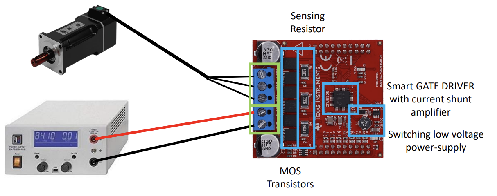
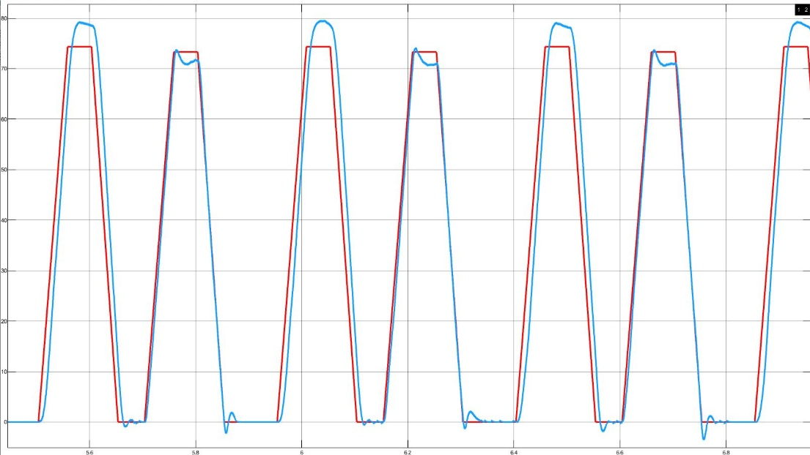
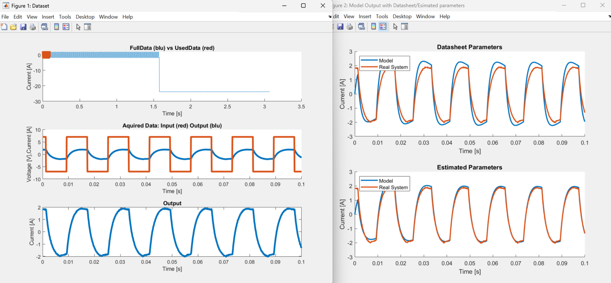
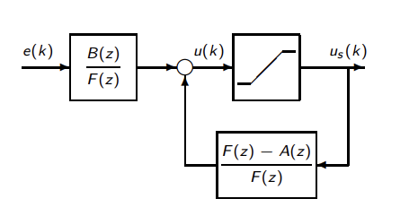
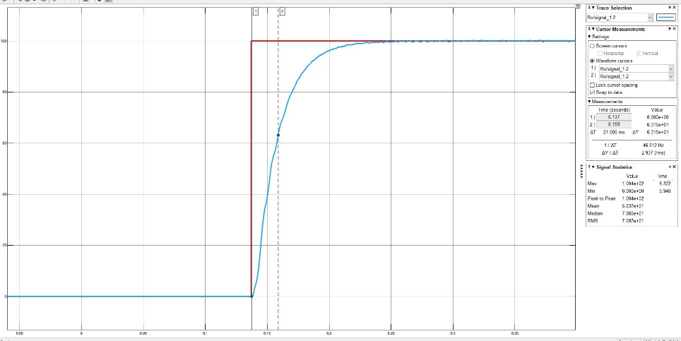
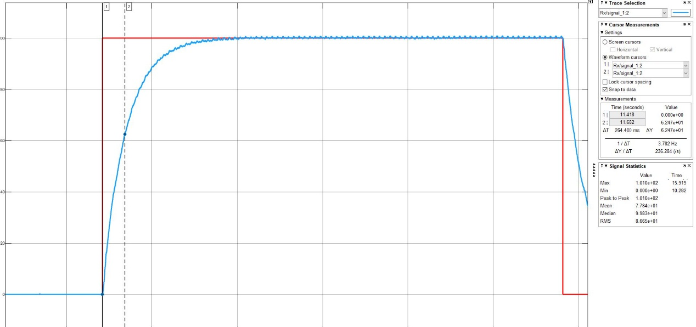

# DC Motor Control on TI C2000 (LAUNCHXL-F28379D)

Model-based design, identification and digital control of a brushed DC motor, from Simulink to real hardware.
Every controller in this repository was auto-coded with Embedded Coder, deployed on a TI C2000 MCU and validated on the physical motor.

> Course project for **Laboratory of Automation Systems** (A.Y. 2024/25)
> by Samuele Pilati, Giorgio Giaretta and **Tommaso Magelli**.
> Full report: [`docs/LAS_Report_Pilati_Giaretta_Magelli.pdf`](docs/LAS_Report_Pilati_Giaretta_Magelli.pdf)

## Highlights

- **Cascaded PI control** (inner current loop + outer speed loop) tuned by pole-zero cancellation, discretized with Tustin and written as MATLAB Function blocks with **anti-windup** clamping.
- **PWM-synchronized ADC sampling** at 10 kHz to reject the current ripple, plus a low-pass filter on encoder speed.
- **Trajectory tracking with acceleration feedforward** on a trapezoidal velocity profile.
- **Least-squares system identification** of R, L, J and b from data logged on the real motor.
- **Analytical discrete-time controllers**: Deadbeat and Dahlin, both with a polynomial F(z) anti-windup scheme.
- **Bonus**: online Recursive Least Squares (RLS) estimator with forgetting factor (documented in the report).

## Hardware and toolchain

| Component | Part |
|---|---|
| MCU | TI LAUNCHXL-F28379D (C2000, 200 MHz) |
| Power stage | TI BOOSTXL-DRV8305EVM |
| Motor | PMB 1524 brushed DC motor, coupled to a brushless motor used as load |
| Feedback | Incremental quadrature encoder (2048 PPR, x4 decoding) |
| Software | MATLAB / Simulink R2023a, C2000 Microcontroller Blockset, Embedded Coder, TI Code Composer Studio |

Two operating modes were used: *Monitor & Tune* for quick debugging, and *Build, Deploy & Start*, where the controller runs standalone on the MCU while a host-side Simulink model (`CommandInterface.slx`) streams high-rate data over serial for offline analysis.

## Repository structure

Each folder is one lab stage and is self-contained (models + parameter script + data).

| Folder | What it contains |
|---|---|
| [`01_intro_c2000`](01_intro_c2000) | First C2000 models: ePWM generation, ADC sampling, audible low-frequency PWM test |
| [`02_cascade_pi_control`](02_cascade_pi_control) | Cascaded current/speed PI controller with anti-windup, deployed on the MCU |
| [`03_tracing_and_filtering`](03_tracing_and_filtering) | Data logging via serial `CommandInterface`, speed filter tuning, datasheet vs estimated comparison plot |
| [`04_trajectory_feedforward`](04_trajectory_feedforward) | Trapezoidal reference trajectory and acceleration feedforward |
| [`05_ls_estimation_RL`](05_ls_estimation_RL) | Least-squares estimation of armature resistance and inductance |
| [`06_ls_estimation_Jb`](06_ls_estimation_Jb) | Least-squares estimation of inertia and viscous friction |
| [`07_deadbeat_control`](07_deadbeat_control) | Deadbeat controller design and hardware model with F(z) anti-windup |
| [`08_dahlin_control`](08_dahlin_control) | Dahlin controller design (tunable closed-loop time constant λ) |
| [`docs`](docs) | Final report (PDF) and figures |

## Results

### Cascaded PI tuning

| Loop | Design rule | Target |
|---|---|---|
| Current | Ti = L/R, Kp = L/τi | τi = 1 ms |
| Speed | Ti = J/b, Kp = J/(τω·Km) | τω = 10·τi = 10 ms |

Sampling time Ts = 100 µs, PWM at 10 kHz.

### Feedforward trajectory tracking

Feedforward current iff = (J/Km)·dωref/dt is added to the speed-PI output. In the plot it is enabled on every other trapezoid: the tracking error during acceleration drops noticeably when it is on.

### Least-squares identification

The electrical and mechanical dynamics were identified separately (locked rotor for R and L; alternating speed for J and b) using a backward-difference regression model y(k) = α1·y(k−1) + α2·u(k).

| Parameter | Datasheet | Estimated |
|---|---|---|
| R (Ω) | 3.2 | **3.46** |
| L (mH) | 4.1 | **6.3** |
| J (kg·m²) | 7.32·10⁻⁵ (motor + load rotor) | **7.91·10⁻⁵** |
| b (N·m·s/rad) | n/a | **6.33·10⁻⁴** |

With the estimated parameters the speed PI responds slightly faster. The largest deviation from the datasheet-tuned controller is about 4 rad/s at startup, and the steady-state ripple stays below 1%.

### Deadbeat vs Dahlin

Both controllers are derived analytically as D(z) = Gm(z) / (Gp(z)·(1 − Gm(z))) and implemented with an F(z) anti-windup loop:

| Controller | Setting | Measured time constant |
|---|---|---|
| Deadbeat | no load / with load | 21.5 ms / 28.4 ms |
| Dahlin | λ = 0.2 | 264 ms |
| Dahlin | λ = 0.02 | 33.7 ms |

Deadbeat gives the fastest response at the cost of aggressive control effort. Dahlin trades speed for a smoother, tunable response.

| Deadbeat step response | Dahlin step response (λ = 0.2) |
|---|---|
|  |  |

## How to run

1. Open the stage folder in **MATLAB R2023a** (or newer).
2. Run the parameter script first (`parameters.m`, or `*_Parameters_Student.m` for stages 07–08). It loads motor constants, PWM/ADC settings and controller gains into the workspace.
3. Open the Simulink model:
   - **Simulation only**: models such as `LR_Model.slx`, `Jb_Model.slx` and `DeadbeatModel_Student.slx` run without hardware. The estimation scripts (`*_estimation_DCMotor.m`) load the logged `.mat` data and call them directly.
   - **On hardware**: models such as `BaseModelForControl.slx` and `BasePerTracing_2023a.slx` need the C2000 Microcontroller Blockset and a LAUNCHXL-F28379D. Use *Build, Deploy & Start*, then open `CommandInterface.slx` on the host to log data. Set the serial port (`comport = "COM8"` in `parameters.m`) to match your machine.

## Notes

- Code generated by Embedded Coder (`slprj/`, `*_ert_rtw/`, `.obj`, `.out`) is not tracked. It is regenerated on every build.
- Files with `_Student` in the name started from course templates and were completed by the team.
- The RLS online estimator from the bonus chapter is described in the report. Its Simulink model is not part of this repository.
